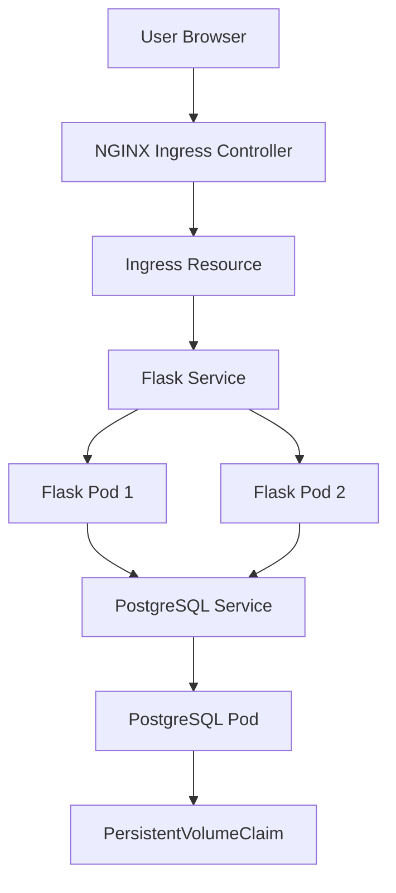
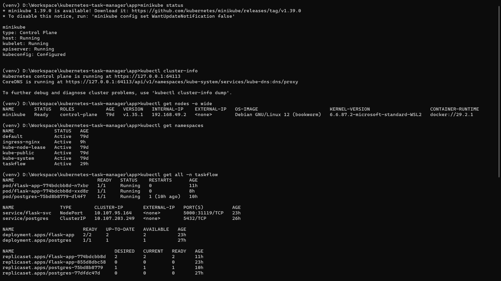
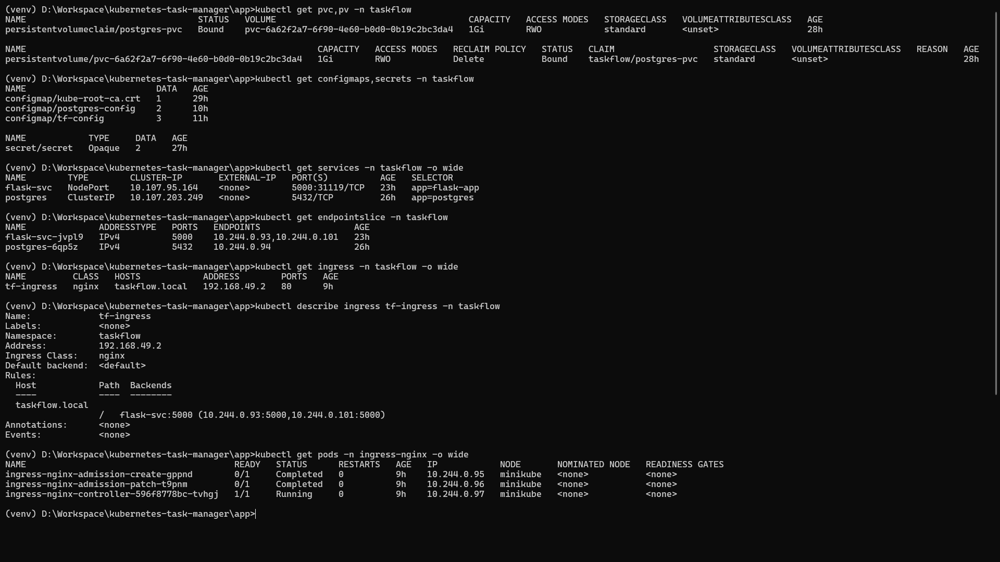
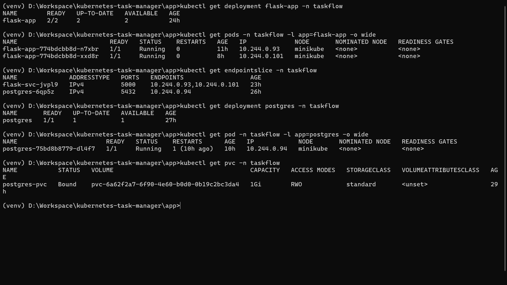
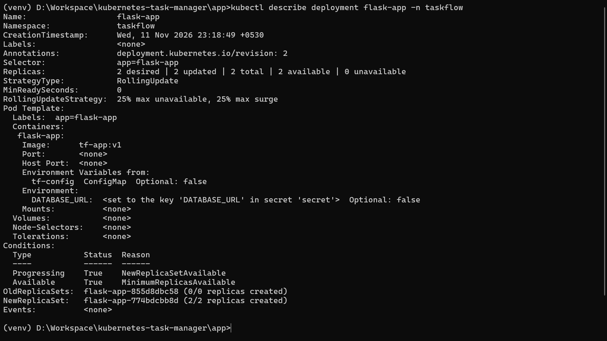
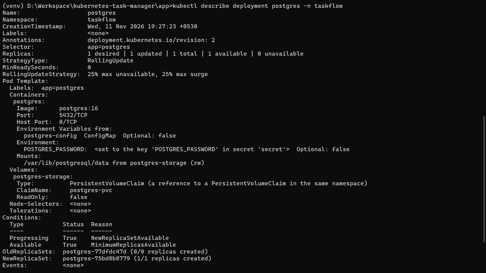
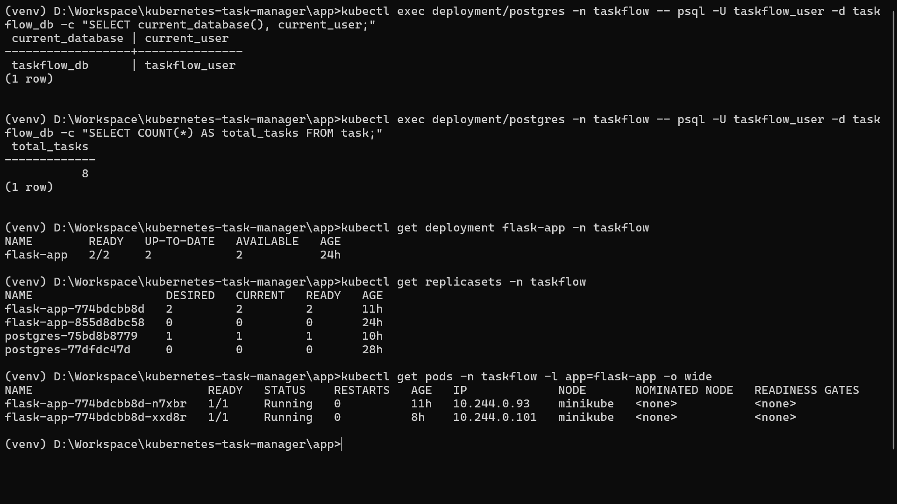
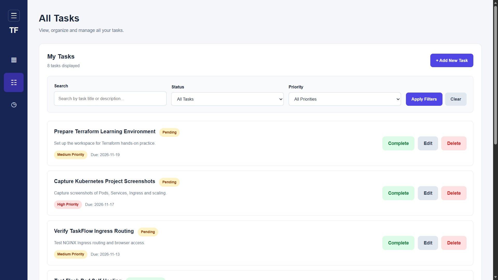
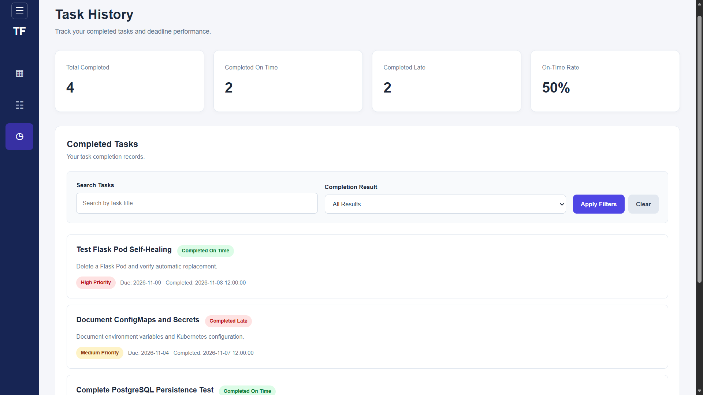
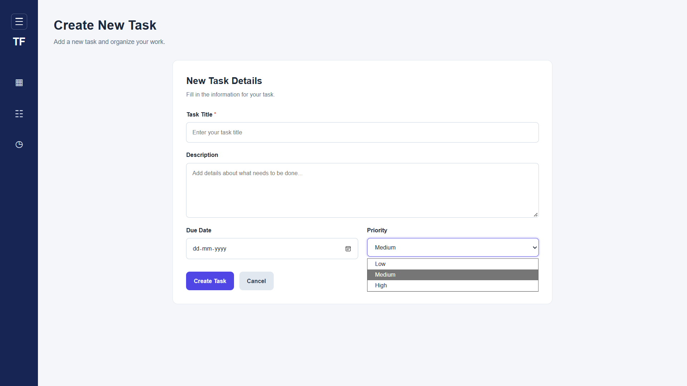

# TaskFlow - Kubernetes-Based Task Management Application

A containerized task management application deployed on Kubernetes using Flask, PostgreSQL, Docker and Minikube.

## Project Overview

TaskFlow is a web-based task management application developed using Flask and PostgreSQL. It provides a simple interface to create, organize, track and manage daily tasks.

The application is containerized using Docker and deployed on a local Kubernetes cluster using Minikube.

This project demonstrates practical implementation of Kubernetes Deployments, Pods, Services, ConfigMaps, Secrets, Persistent Volumes, Ingress, application scaling and self-healing.

## Objectives

- Develop and containerize a Flask-based task management application.
- Deploy a multi-container application on Kubernetes.
- Integrate PostgreSQL as the application database.
- Configure persistent storage for PostgreSQL.
- Manage application configuration using ConfigMaps and Secrets.
- Expose the application using Kubernetes Services and Ingress.
- Demonstrate replica scaling and Pod self-healing.
- Understand Kubernetes resource management through hands-on implementation.

## Technology Stack

| Category | Technologies |
|---|---|
| Application | Python, Flask |
| Frontend | HTML, CSS, JavaScript |
| Database | PostgreSQL 16 |
| Containerization | Docker |
| Orchestration | Kubernetes, Minikube |
| Networking | Kubernetes Services, NGINX Ingress |
| Configuration | ConfigMaps, Secrets |
| Storage | PersistentVolume, PersistentVolumeClaim |
| Development Environment | Windows, VS Code, CMD |

## Architecture

The application uses a Flask application connected to a PostgreSQL database through an internal Kubernetes Service.

The application is exposed externally through an NGINX Ingress Controller.



## Application Features

### Dashboard

- Total task count
- Pending tasks
- Overdue tasks
- Completed tasks

### Task Management

- Create new tasks
- View all tasks
- Manage task details
- Track task priorities and due dates
- Monitor task completion status

### Task History

- Total completed tasks
- Tasks completed on time
- Tasks completed late
- On-time completion rate

## Project Structure

```text
kubernetes-task-manager/
│
├── app/
│   ├── instance/
│   ├── static/
│   │   ├── css/
│   │   │   └── style.css
│   │   └── js/
│   │       └── app.js
│   ├── templates/
│   │   ├── base.html
│   │   ├── dashboard.html
│   │   ├── history.html
│   │   ├── tasks.html
│   │   └── task_form.html
│   ├── app.py
│   └── requirements.txt
│
├── k8s/
│   ├── flask-config.yaml
│   ├── flask-deployment.yaml
│   ├── flask-service.yaml
│   ├── postgres-config.yaml
│   ├── postgres-deployment.yaml
│   ├── postgres-pvc.yaml
│   ├── postgres-service.yaml
│   ├── secret.example.yaml
│   └── ingress.yaml
│
├── screenshots/
├── Dockerfile
├── docker-compose.yaml
├── .dockerignore
├── .gitignore
└── README.md
```

The actual `secret.yaml`, local virtual environment and local database files are excluded from version control.

## Kubernetes Implementation

### 1. Namespace

Created a dedicated Kubernetes namespace named `taskflow` to organize application resources.

### 2. PostgreSQL Deployment

- Deployed PostgreSQL 16 inside Kubernetes.
- Configured database name and username through a ConfigMap.
- Used a Kubernetes Secret for database credentials.
- Mounted persistent storage using a PersistentVolumeClaim.

### 3. Flask Deployment

- Built the Flask application into a Docker image.
- Used Gunicorn to run the application.
- Deployed the application using a Kubernetes Deployment.
- Configured environment variables through ConfigMaps and Secrets.
- Ran two Flask replicas.

### 4. Kubernetes Services

| Service | Type | Purpose |
|---|---|---|
| flask-svc | NodePort | Exposes the Flask application |
| postgres | ClusterIP | Provides internal database connectivity |

The Flask application communicates with PostgreSQL using the internal Service DNS name `postgres`.

### 5. ConfigMaps and Secrets

ConfigMaps manage non-sensitive application and database configuration.

Kubernetes Secrets provide database credentials and the application database connection string.

Actual Secret values are not included in the public repository.

### 6. Persistent Storage

Configured a PersistentVolumeClaim with a storage request of 1Gi for PostgreSQL.

This provides persistent storage for database files independently of the PostgreSQL Pod lifecycle.

### 7. Ingress

Configured the NGINX Ingress Controller to route external HTTP traffic to the Flask Service.

Application access:

`http://taskflow.local`

On Windows with the Minikube Docker driver, the local hosts file is configured to resolve `taskflow.local` to `127.0.0.1`, and `minikube tunnel` is used to provide access.

### 8. Scaling

Demonstrated horizontal scaling of the Flask Deployment.

- Scaled from one replica to three replicas.
- Scaled down to one replica.
- Configured the final Deployment with two replicas.
- Verified the corresponding Pod and EndpointSlice changes.

### 9. Self-Healing

Demonstrated Kubernetes self-healing by manually deleting a running Flask Pod.

The Deployment-managed ReplicaSet automatically created a replacement Pod to maintain the desired replica count.

## Deployment Guide

### Prerequisites

- Docker Desktop
- Minikube
- kubectl
- Git
- Python

### Step 1: Clone the Repository

```cmd
git clone <YOUR-GITHUB-REPOSITORY-URL>
cd kubernetes-task-manager
```

### Step 2: Start Minikube

```cmd
minikube start --driver=docker
```

Verify:

```cmd
minikube status
kubectl get nodes
```

### Step 3: Build the Docker Image

From the project root:

```cmd
docker build -t tf-app:v1 .
```

Load the image into Minikube:

```cmd
minikube image load tf-app:v1
```

### Step 4: Create the Namespace

```cmd
kubectl create namespace taskflow
```

### Step 5: Configure Kubernetes Secrets

Create a local copy of `k8s/secret.example.yaml` named `k8s/secret.yaml`.

Replace the placeholder credentials with your own values.

Do not commit the actual `secret.yaml` file.

### Step 6: Apply PostgreSQL Resources

```cmd
kubectl apply -f k8s/postgres-config.yaml
kubectl apply -f k8s/postgres-pvc.yaml
kubectl apply -f k8s/secret.yaml
kubectl apply -f k8s/postgres-deployment.yaml
kubectl apply -f k8s/postgres-service.yaml
```

### Step 7: Apply Flask Resources

```cmd
kubectl apply -f k8s/flask-config.yaml
kubectl apply -f k8s/flask-deployment.yaml
kubectl apply -f k8s/flask-service.yaml
```

### Step 8: Enable Ingress

```cmd
minikube addons enable ingress
```

Apply the Ingress configuration:

```cmd
kubectl apply -f k8s/ingress.yaml
```

### Step 9: Configure Local Access

Add the following entry to the Windows hosts file:

```text
127.0.0.1 taskflow.local
```

Run the following command in an Administrator CMD window and keep it running:

```cmd
minikube tunnel
```

Open the application:

`http://taskflow.local`

### Step 10: Verify Deployment

```cmd
kubectl get all -n taskflow
kubectl get pvc -n taskflow
kubectl get ingress -n taskflow
```

## Screenshots and Implementation Evidence

The following screenshots document the Kubernetes environment, application configuration, database connectivity, scaling and TaskFlow user interface.

### Kubernetes Infrastructure

**01. Minikube Cluster Status**



**02. Kubernetes Networking Configuration**



**03. Pod and Storage Status**



### Application and Database Configuration

**04. Flask Deployment**



**05. PostgreSQL Deployment**



**06. Database Connectivity and Scaling**



### TaskFlow Application

**07. Create Task Page**


**08. Dashboard**



**09. All Tasks**



**10. Task History**



## Key Learnings

Through this project, I gained practical experience with:

- Containerizing a Flask application using Docker.
- Deploying multiple application components on Kubernetes.
- Managing Kubernetes Deployments and Services.
- Configuring application settings using ConfigMaps and Secrets.
- Connecting application Pods to PostgreSQL through internal Service discovery.
- Configuring persistent storage for database workloads.
- Exposing applications using NGINX Ingress.
- Scaling application replicas.
- Understanding ReplicaSet-based self-healing.
- Troubleshooting Kubernetes resources using kubectl.

## Future Improvements

- Implement CI/CD automation using GitHub Actions or Jenkins.
- Introduce infrastructure provisioning using Terraform.
- Integrate Prometheus and Grafana for monitoring.
- Add container image vulnerability scanning.
- Explore deployment automation and Kubernetes security practices.

---

**Project:** TaskFlow - Kubernetes-Based Task Management Application
**Focus:** Cloud and DevOps Engineering